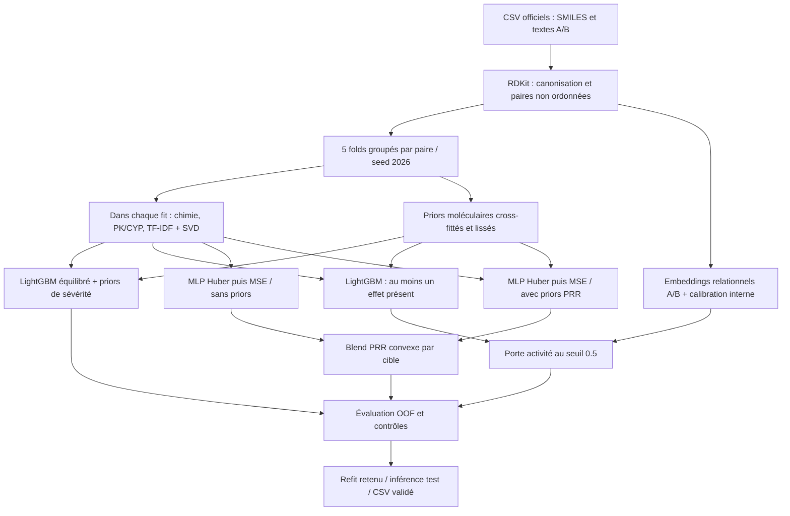

# DeepPharma

Un pipeline multimodal CPU pour prédire la sévérité d'une interaction entre
deux molécules, 50 effets indésirables binaires et 50 valeurs de PRR
(**Proportional Reporting Ratio**, une mesure de disproportionnalité).
Projet de recherche associé à la compétition
[Deep-Pharma / DataHack 3.0](https://www.kaggle.com/competitions/deep-pharma-multimodal-intelligence-challenge-data-hack-3-0).
**Ce n'est ni un outil clinique, ni une estimation de risque individuel.**

## Pipeline retenu

Le candidat de référence est `severity_activity_v1` : un ensemble de modèles
spécialisés, pas un GNN global. Chaque tâche a sa propre fonction objectif.



### Pourquoi ces choix ?

- **Représentation multimodale.** RDKit calcule empreintes Morgan et descripteurs
  physico-chimiques ; les textes officiels apportent TF-IDF/SVD et indices PK/CYP.
  Les transformations apprises sont ajustées dans le fit du fold.
  La fusion symétrique évite de distinguer artificiellement A+B de B+A :
  $\phi(A,B)=[u_A+u_B,\ |u_A-u_B|,\ u_A\odot u_B]$.
- **Priors moléculaires.** Les statistiques supervisées par molécule sont lissées
  vers une moyenne globale. Pour les lignes d'apprentissage, elles sont
  cross-fittées : leur propre groupe de paires est exclu du calcul.
  Ce sont des statistiques de *combinaisons*, pas des profils mesurés en monothérapie.
- **Severity : LightGBM équilibré**, 250 arbres, 31 feuilles, taux 0,04,
  régularisation L2=2 et priors de classe. Les poids de classes donnent davantage
  d'importance aux classes rares, en cohérence avec le macro-F1.
- **Binary : factorisation relationnelle.** Embeddings moléculaires de dimension 32,
  MLP de largeur 128, dropout 0,15, têtes Binary/PRR entraînées conjointement.
  Seule sa sortie Binary est retenue ; calibration de Platt et seuil micro-F1
  sont appris sur une partition interne. Elle exploite les molécules déjà vues
  (*warm/warm*), mais ne garantit pas la généralisation à une molécule inconnue.
- **Porte d'activité.** Un second LightGBM prédit si la paire présente au moins
  un effet. Au seuil fixé 0,5, il annule les sorties Binary des paires prédites
  inactives pour limiter les faux positifs. Il ne modifie ni Severity ni PRR :
  $\widehat b_j=\mathbf1[p_j\geq\tau]\,\mathbf1[p_{\mathrm{actif}}\geq0.5]$.
- **PRR : deux MLP PyTorch** de dimensions cachées 256/128, SiLU, BatchNorm,
  dropout 0,15 et sortie Softplus positive. L'un utilise les priors, l'autre non.
  Huber masquée stabilise l'apprentissage, puis trois époques de MSE masquée
  rapprochent l'objectif du score. Normalisation par cible (quantile positif 95 %),
  AdamW, clipping et scheduler limitent les instabilités.
  Le mélange final utilise un poids par effet, ajusté sur le fit et borné dans [0,1] :

$$
\widehat r_j=w_j\widehat r_{j,\mathrm{priors}}+(1-w_j)\widehat r_{j,\mathrm{base}}.
$$

Le PRR est **conditionnel aux valeurs positives**, sans multiplication par la
probabilité Binary : la métrique ne pénalise que les cellules où le vrai PRR > 0.
Il ne représente pas une probabilité d'effet indésirable.

## Score et limites de validation

Avec $M=\{(i,j):r_{ij}>0\}$, les métriques sont calculées sur les PRR **bruts** :

$$
\mathrm{RMSE}_{\mathrm{masked}}=
\sqrt{\frac{1}{|M|}\sum_{(i,j)\in M}(r_{ij}-\widehat r_{ij})^2},
\qquad S_{\mathrm{PRR}}=\frac{1}{1+\mathrm{RMSE}_{\mathrm{masked}}}.
$$

$$
S=0.4\,F_{1,\mathrm{macro}}^{\mathrm{Severity}}
+0.3\,F_{1,\mathrm{micro}}^{\mathrm{Binary}}+0.3\,S_{\mathrm{PRR}}.
$$

| Résultat du candidat retenu | Valeur |
|---|---:|
| OOF groupé, 5 folds : score global | 0,581304 |
| Severity macro-F1 / Binary micro-F1 | 0,740105 / 0,761344 |
| PRR : RMSE masqué / score | 4,276179 / 0,189531 |
| Score public Kaggle enregistré le 01/10/2026 | 0,60056 |

Le précédent score public enregistré était 0,57320, soit **+0,02736**.
Ces valeurs publiques proviennent du registre local, pas d'une vérification live
du leaderboard. Le score public ne fournit pas de décomposition par tâche.

**Limite importante :** l'OOF PRR historique choisit ses checkpoints sur le fold
externe ensuite scoré ; les poids du blend utilisent des prédictions du fit,
pas une calibration entièrement OOF interne. Les choix de branches ont aussi
été comparés sur ces folds. L'OOF ci-dessus est donc un résultat de développement,
**pas une estimation strictement indépendante**, même sans mélange de paires
ni utilisation des labels du test. Une confirmation lockbox distincte et des
benchmarks d'optimisation imbriquée sont disponibles dans le code.

Les doublons et paires inversées restent dans le même fold. Les molécules peuvent
en revanche apparaître de part et d'autre : les stress-tests *cold-start* sont
séparés. Le test officiel ne sert pas au fit, à la calibration ou au score local.
Le verrou de soumission exige un gain local et des audits cohérents ; aucun
script ne soumet automatiquement sur Kaggle.

## Utilisation locale

Python **3.12**, [uv](https://docs.astral.sh/uv/) et Windows/PowerShell :

```powershell
uv sync --python 3.12 --locked
.\scripts\check.ps1
# Accepter personnellement les règles Kaggle avant téléchargement.
.\scripts\auth_kaggle.ps1
.\scripts\download_data.ps1
.\scripts\run_validation.ps1
```

Les trois fichiers officiels vont dans `data/raw/`. Ils ne sont **pas distribués**.
Pour reconstruire les branches et les artefacts prérequis, suivre
[le guide de reproduction](docs/reproduction.md). Aucun entraînement coûteux
n'est lancé pendant les tests unitaires.

## Code et expériences

`src/deep_pharma/` contient les features, modèles, métriques et garde-fous ;
`configs/` leurs paramètres ; `tests/` les tests synthétiques ; `scripts/` les commandes.
GNN multivue, CDN, experts d'extrêmes et optimisation imbriquée sont des
**expériences**, non des composants du candidat retenu.

L'[explorateur de combinaisons](docs/combination_profiles.md) et le
[graphe d'effets](docs/effect_graph_user_guide.md) sont des interfaces de recherche
locales indépendantes de la soumission. Les dessins RDKit sont des topologies 2D,
pas des structures 3D ni une démonstration d'interaction causale.

## Licence et données

Le code original est sous [licence MIT](LICENSE). Les composants tiers conservent
[leurs licences et attributions](THIRD_PARTY_NOTICES.md).
Cette licence ne s'applique **pas** aux données Kaggle. Aucun CSV, poids entraîné,
cache, token ou HTML contenant les données n'est publié. Téléchargez les données
via votre propre compte et respectez les
[règles de la compétition](https://www.kaggle.com/competitions/deep-pharma-multimodal-intelligence-challenge-data-hack-3-0/rules).
